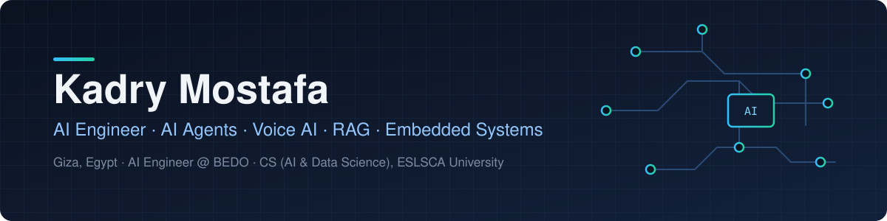

  

  
  
  
  

## About me

I'm an AI engineer who builds **AI agents, voice agents and RAG systems**, and the embedded hardware they can run on.

- **AI Engineer at [BEDO](https://bedoeg.com) since 2023,** during university summers and full-time since graduating. I build agentic AI systems that speed up production work across several of the company's departments.
- **Embedded Engineer at BEDO, 2021–2023.** I designed and programmed engineering training kits (8051, PIC, AVR, Arduino, Raspberry Pi and STM32 ARM trainers) for universities and technical schools.
- **B.Sc. Computer Science, AI & Data Science, ESLSCA University (2023–2026).** GPA 3.8, with the university's *Continuous Achievement* certificate.
- **Team lead on GradVoice,** our graduation project. I built the voice agent and the RAG / context-injection layer, and integrated the full system.

## Featured projects

| Project | What it does | Built with |
| --- | --- | --- |
| **[GradVoice](https://github.com/kadry720/GradVoice)** | AI recruitment platform. Scores a CV against a job description across 8 hiring dimensions, then runs a **live AI voice screening interview** over WebRTC with transcripts and recruiter notes. Includes an Android and iOS app. I led the 4-person team. | Azure OpenAI GPT-4.1, GPT-4o Transcribe and TTS, Flair NER, Flask, Next.js, Capacitor |
| **[Fraud Detection MLOps](https://github.com/kadry720/fraud-detection-mlops)** | End-to-end MLOps pipeline on IEEE-CIS fraud data: data-validation gate in CI, 8 models tracked in MLflow, FastAPI serving, Prometheus/Grafana dashboards and drift monitoring. **ROC-AUC 0.91, F1 0.68** on 20,000 held-out transactions. | MLflow, DVC, Docker, FastAPI, GitHub Actions, Evidently |

## What I work with

**AI and LLMs**
 

**MLOps and backend**
 

**Embedded and Edge AI**
 

**Languages**
 

## Work with me

I take freelance projects in **AI agents and automation, voice AI, RAG/LLM apps, MLOps and Edge AI**. Email me at **[kadryelbidweihy@gmail.com](mailto:kadryelbidweihy@gmail.com)** or message me on [LinkedIn](https://www.linkedin.com/in/kadry-mostafa-14a390359/).

Languages: Arabic (native) · English (fluent) · German (intermediate)
